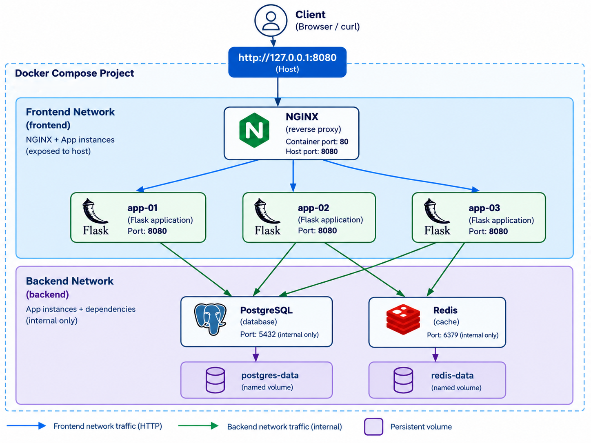

# Multi Instance Containerized Backend Platform

<p align="center">
	
	
	
	
	
	
</p>

Load-balanced Flask backends behind NGINX, with PostgreSQL and Redis services. The stack runs as three instances by default



## Prerequisites

- Linux or WSL2, Docker Desktop/Engine with Compose v2, Python 3.12, Git.
- 2 CPU cores / 4 GB free RAM / 3 GB free disk, plus Docker overhead.

## Setup

```bash
git clone <repo-url>
cd Multi-Instance-Containerized-Backend-Platform
cp .env.example .env
```

## Build and start

```bash
docker compose -p my-api up --build -d
docker compose -p my-api ps
```

Wait for every service to report `healthy`, then confirm the stack:

```bash
curl -i http://127.0.0.1:8080/
curl -i http://127.0.0.1:8080/health
curl -i http://127.0.0.1:8080/ready
curl -i http://127.0.0.1:8080/instance
curl -H 'Content-Type: application/json' -d '{"title":"demo"}' http://127.0.0.1:8080/records
curl http://127.0.0.1:8080/records
curl http://127.0.0.1:8080/counter
```

## App-only tests (no Docker/DB required)

```bash
python3 -m venv .venv && source .venv/bin/activate
python -m pip install -r requirements.txt
python -m unittest discover -s tests -v
```

## Validate the full environment

```bash
python validate.py --url http://127.0.0.1:8080
```

Checks public access, every required endpoint, both/all backends answering
through NGINX, PostgreSQL/Redis readiness, and network isolation
(NGINX not on the backend network; PostgreSQL/Redis publish no host ports).
Exits non-zero on any failure.

## Failure / recovery test

```bash
python failure_test.py --url http://127.0.0.1:8080 --target app-02
```

Stops `app-02`, proves traffic keeps flowing through `app-01` & `app-03` with zero
client-visible 5xx, restarts `app-02`, and proves it serves requests again.
Always restarts the target in a `finally` block, even on failure.

## Backup and restore (PostgreSQL persistence proof)

```bash
curl -H 'Content-Type: application/json' -d '{"title":"persistence-check"}' http://127.0.0.1:8080/records
./backup.sh backups                 # writes backups/my_api_tasks_<timestamp>.sql, verifies it is non-empty
docker compose -p my-api stop app-01 app-02 app-03 postgres
docker compose -p my-api rm -f app-01 app-02 app-03 postgres
docker compose -p my-api up -d              # postgres-data volume is NOT removed
curl http://127.0.0.1:8080/records                   # the record survives container recreation
./restore.sh backups/<file>.sql     # drops and reloads the records table, proves row count >= 1
```

## CI

`.github/workflows/ci.yaml` runs on every push and pull request: checkout,
Gitleaks secret scan, Python syntax check, app-only unit tests, shell syntax
check, `docker compose config`, image build, Trivy image scan, stack start,
bounded readiness wait, `validate.py`, `failure_test.py`, `backup.sh`,
`restore.sh`, then teardown. Any failing step fails the run.

## Stop and clean up

```bash
docker compose -p my-api down          # keeps the postgres-data/redis-data volumes
docker compose -p my-api down --volumes  # only when you intend to discard persisted data
```

Avoid global `docker system prune` — it can remove unrelated containers/images.
